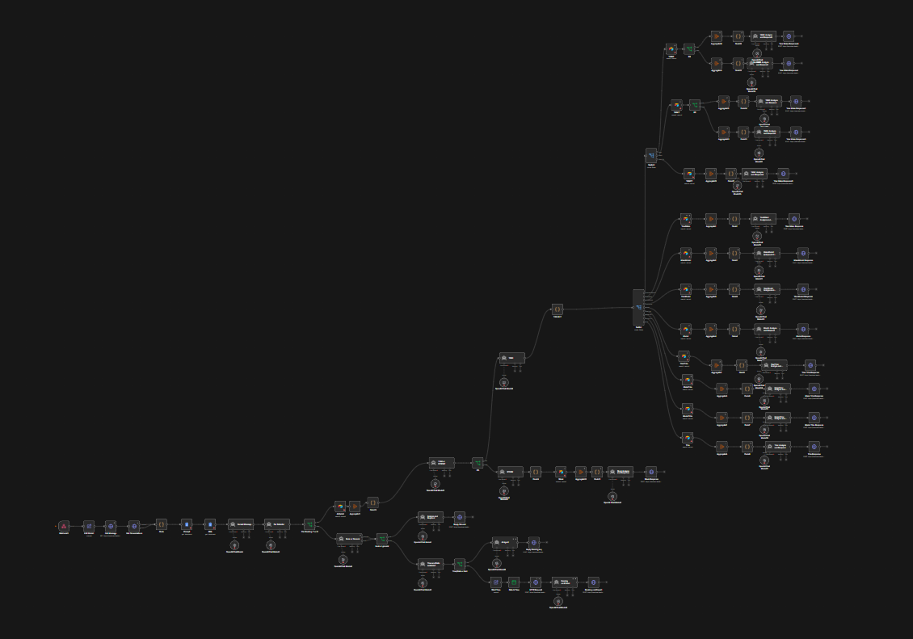
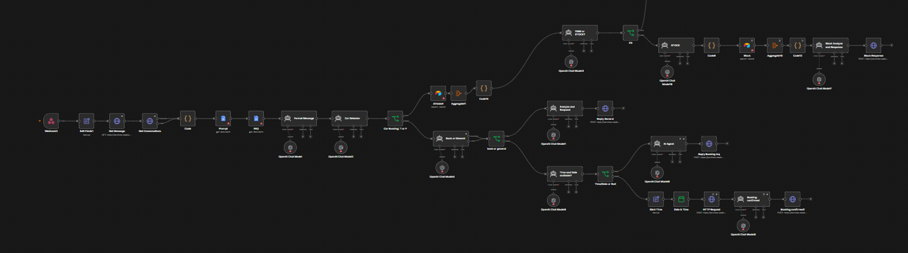
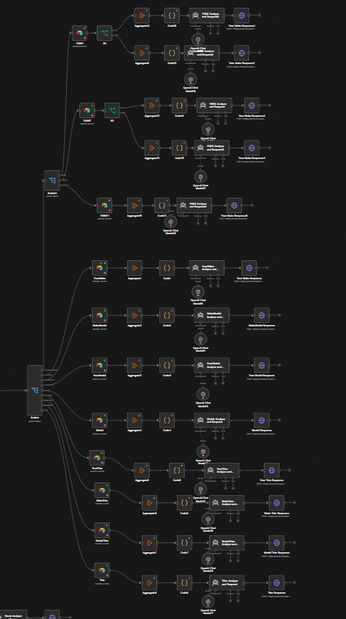

# AI Sales Chatbot for Car Dealerships (n8n + GoHighLevel)

A 128-node n8n workflow that acts as an **AI sales assistant for a car dealership**. It replies to customer SMS and chat messages in **GoHighLevel (GHL)**, answers questions about **live vehicle inventory** stored in Airtable, and **books showroom appointments** in the GHL calendar.

## What it does

- **Understands the whole conversation.** It pulls the conversation history from GHL and formats it chronologically so every reply has context.
- **Routes the request with LLM classifiers:**
  - *Vehicle question?* → inventory flow
  - *Year/Make/Model or stock number?* → the matching search path
  - *Booking or general question?* → booking flow or FAQ-based answer
- **Searches inventory in Airtable.** It extracts Year, Make, Model, Trim, colour and price from free text, then searches the inventory table using the right combination of filters (Year+Make, Make+Model, Model+Trim, stock number, …). It suggests close matches when the request is vague and asks qualifying questions.
- **Books appointments.** It detects a requested date and time, checks it against business hours (Eastern Time), creates the appointment through the GHL Calendars API, and confirms it with the customer.
- **General questions.** Answers use a system prompt and an FAQ loaded from Google Docs, so the dealership can edit them without touching the workflow.
- **Replies in GHL.** Every reply goes back through the GHL Conversations API as SMS.

| Intake & routing | Inventory search branches |
|---|---|
|  |  |

## Tech stack

n8n · OpenAI (GPT-4o) · GoHighLevel API (Conversations, Calendars) · Airtable · Google Docs

## Setup

1. Import `car-dealership-ai-chatbot.json` into n8n.
2. Create credentials: OpenAI, Airtable Personal Access Token and Google Docs OAuth2.
3. Replace the placeholders:
   - `YOUR_GHL_PRIVATE_INTEGRATION_TOKEN` – GHL private integration token (in every GHL HTTP node's `Authorization: Bearer …` header). Better still, move it into an n8n *Header Auth* credential.
   - `YOUR_GHL_CALENDAR_ID` – the calendar used for appointments
   - `YOUR_AIRTABLE_BASE_ID` / `YOUR_AIRTABLE_TABLE_ID` – your inventory table (columns such as Year, Make, Model, Trim, Exterior, AdvertisingPrice, Odometer, Stock)
   - `YOUR_GOOGLE_DOC_ID` – two Google Docs: the assistant's system prompt and the dealership FAQ
4. In GHL, create a workflow that sends inbound messages to this workflow's webhook (`/webhook/Chatteraiv2`) with the contact's name, phone, last message and assigned user in `customData`.
